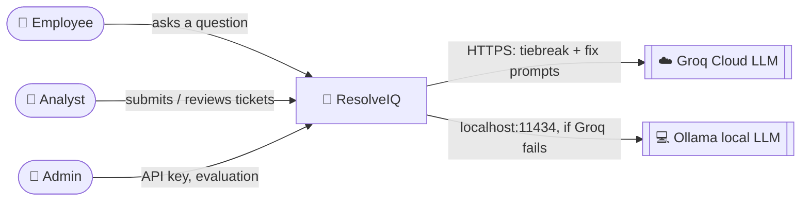
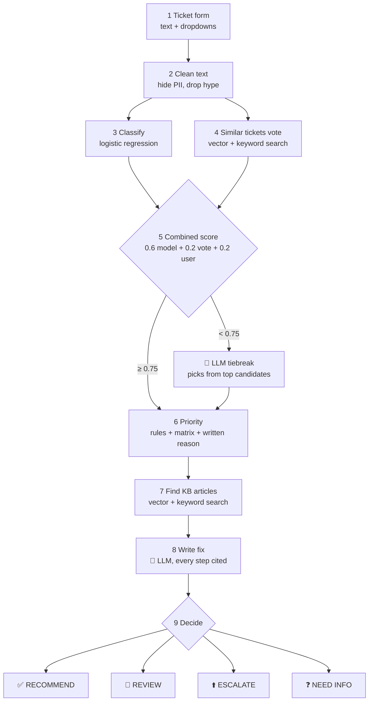
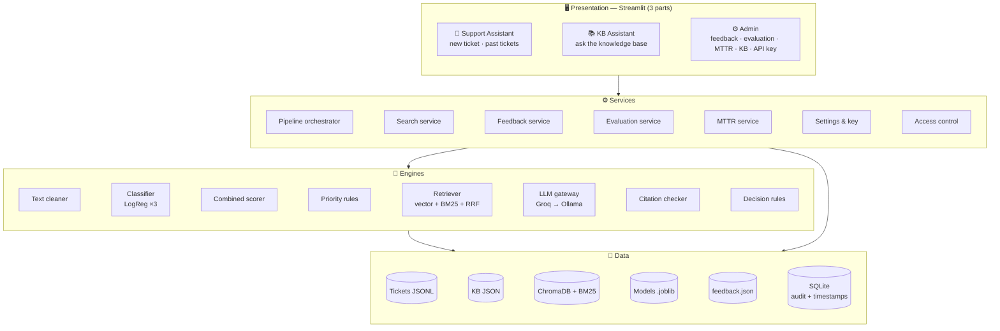
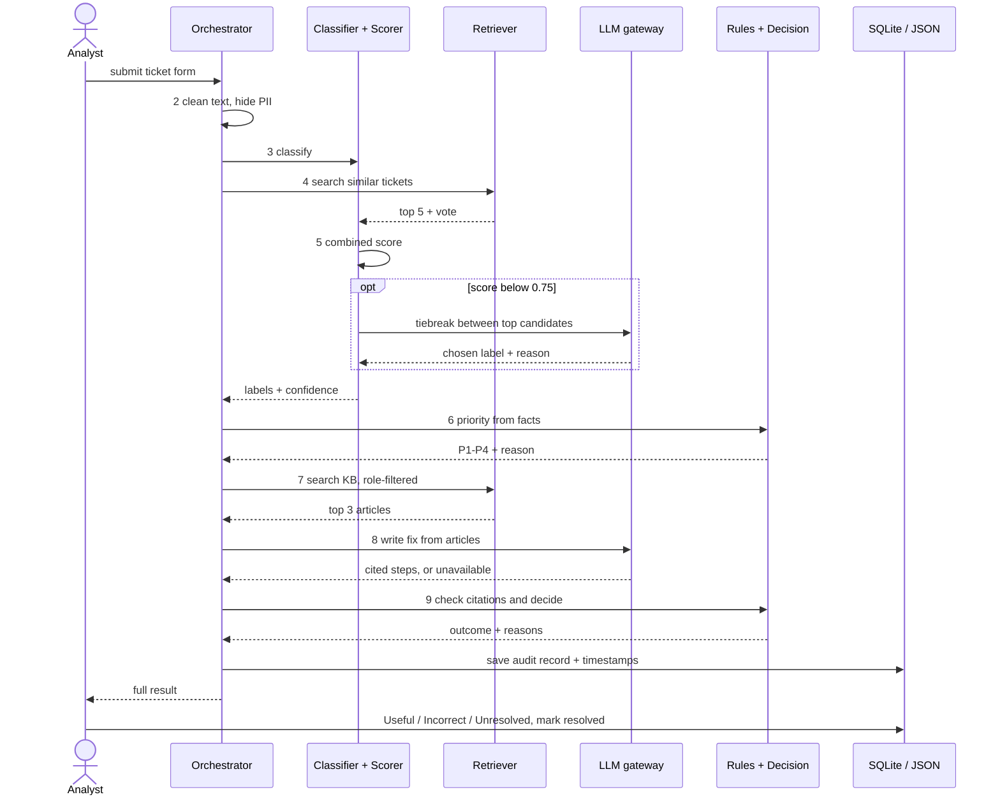
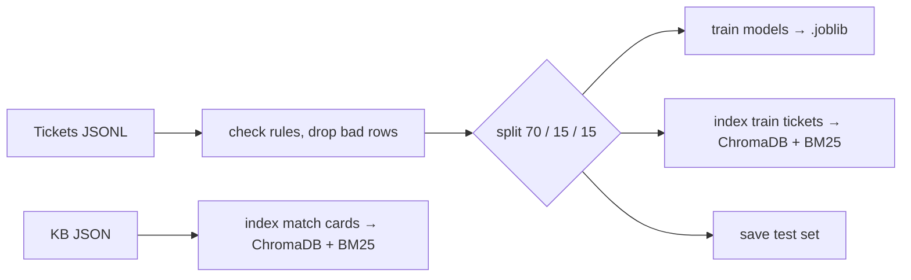
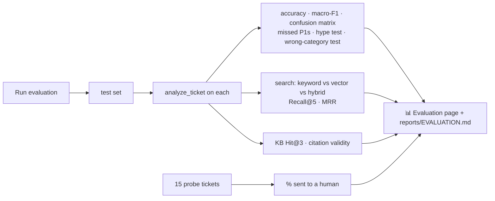
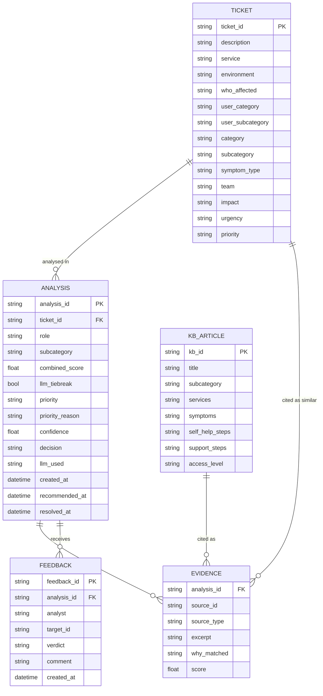

# ResolveIQ — High-Level Design (HLD)

*Intelligent IT Ticket Analysis & Resolution Assistant · HCLTech hackathon*

| Item | Value |
|---|---|
| Purpose | Analyse incoming IT tickets, find similar past cases, recommend a cited fix, cut MTTR |
| Scope | Analyse + recommend only. No auto-closure, no system changes, no production ITSM writes |
| Users | Employee (asks the KB) · Analyst (works tickets) · Admin (key, feedback, evaluation) |
| Data | **Our own curated dataset**: 1,200 synthetic tickets + 55 KB articles (all labels generated, stated as such) |
| Deployment | Single machine, Streamlit app, local files, Groq cloud LLM with local Ollama fallback |

**Who does what**

| Job | Done by | Never done by |
|---|---|---|
| Category, subcategory, symptom type | 🧠 ML models (logistic regression) | — |
| Team, impact, urgency, priority | 📏 Rules + ITIL matrix | LLM |
| Resolving an unsure classification | 🤖 LLM tiebreak, **only** when the combined score is below 0.75 | — |
| Writing the fix | 🤖 LLM, every step cited to a KB article | — |
| Final decision | 📏 Rules | LLM |

---

## 1. System context

| External system | Data sent | If unavailable |
|---|---|---|
| Groq Cloud | PII-hidden ticket + evidence | use Ollama |
| Ollama (local) | same | tiebreak skipped → REVIEW · fix not written → ESCALATE "LLM unavailable" (evidence still shown) |

---

## 2. The dataset (curated by us)

| File | Made with | Contents |
|---|---|---|
| `data/resolveiq_tickets.jsonl` | `Prompts/DATA_GENERATION_PROMPT.md` | 1,200 tickets |
| `data/knowledge_base/articles.json` | `Prompts/KB_GENERATION_PROMPT.md` | 55 KB articles, every subcategory covered |

**Ticket fields**

| What the user enters (input) | What the system predicts (answer) |
|---|---|
| `description` (free text) | `category` (6) · `subcategory` (18) |
| `service` (14, dropdown) | `symptom_type`: outage / blocked / slow / request / question |
| `environment`: Production / Test / Not applicable | `team` (5) |
| `who_affected`: Just me / My team / Many teams / Customers | `impact`, `urgency`: High / Medium / Low |
| `user_category`, `user_subcategory` (the user's guess) | `priority`: P1–P4 |

- **Trusted facts:** service, environment, who_affected. **May be wrong:** description tone, and the user's own category (wrong ~20% of the time on purpose).
- **Built-in tests:** ~15% of tickets contain hype ("URGENT, I'm the CEO") that must **not** raise priority, and ~20% have a wrong user category that the model must correct.
- **Labels are generated:** answer fields follow the written rules, not real ticket history. Rows that break the rules are dropped before training (`check_rules`).
- **Split:** 70 / 15 / 15 train / validation / test, stratified by subcategory. Only train tickets go into the search index.

**KB article fields:** `kb_id, title, category, subcategory, services[], symptom_types[], symptoms[], error_messages[], cause, self_help_steps[], support_steps[{n, do, expected}], verify, escalate_to, escalate_when, access_level (public | internal), keywords[], related_articles[]`

---

## 3. The pipeline (9 steps)

| # | Step | Input | How | Output |
|---|---|---|---|---|
| 1 | Ticket form | — | Streamlit form: description + 5 dropdowns | raw ticket |
| 2 | Clean text | description | regex: hide emails / phones / IDs · drop hype sentences (`src/text.py`) · completeness check | clean text, `too_vague` flag |
| 3 | Classify | clean text + service | TF-IDF + MiniLM embedding → 3 calibrated logistic regressions (`category`, `subcategory`, `symptom_type`) | label + probability each |
| 4 | Similar tickets vote | clean text | vector (ChromaDB) + keyword (BM25) → RRF merge → +15% if same service. **Doesn't use step 3**, so it's an independent opinion | top 5 tickets + vote = their majority category |
| 5 | Combined score | steps 3, 4 + user's pick | category score = `0.6 × model prob + 0.2 × (vote = category) + 0.2 × (user picked it)`. Subcategory is then chosen only from that category's subcategories | category + subcategory + score |
| 5a | Review flags | step 5 | flag REVIEW if the user's category disagrees, the score is < 0.75, or a **security safety net** fires (Security prob ≥ 0.20, a security cue in the text, or the user picked Security) | `needs_review` + reasons |
| 5b | LLM tiebreak | top 3 candidates + ticket + similar tickets | **only if score < 0.75**: LLM picks one candidate (it can't invent a new label) and gives a reason | label + reason (still REVIEW) |
| 6 | Priority | facts + predicted category & symptom type | `src/rules.py`: team, impact, urgency → Impact × Urgency matrix. **No LLM, tone ignored** | P1–P4 + one-sentence reason |
| 7 | Find KB articles | clean text + subcategory | access filter (role) → vector + keyword → RRF → boost same subcategory (× probability) and service | top 3 articles + match score |
| 8 | Write fix | ticket, labels, top 3 articles, top 5 tickets | LLM (Groq → Ollama) returns JSON. Every step cites a step ID like `KB-020/support/1` · citation check drops steps whose ID or text doesn't match | cited steps + `citation_validity` |
| 9 | Decide | everything above | rules, first match wins (§3.1) | outcome + reasons + confidence |

### 3.1 Decision rules (step 9)

**Confidence** = average of three 0–1 numbers: combined classification score, best KB match score, citation validity.

| # | If | Then |
|---|---|---|
| 1 | description too vague | ❓ NEED INFO, ask 1–2 questions |
| 2 | LLM unavailable, or no KB article matches well enough (**knowledge gap**, logged) | ⬆️ ESCALATE to the predicted team |
| 3 | priority P1 or P2 | ⬆️ ESCALATE (fix still shown to speed up the engineer) |
| 4 | any review flag from step 5a, LLM tiebreak was needed, top 2 articles disagree, or confidence < 0.6 | 👀 REVIEW |
| 5 | otherwise | ✅ RECOMMEND |

Every outcome is shown with its reasons in plain words.

**Measured so far** (`reports/EVALUATION.md`, 180 held-out tickets): category 96.1% (vs 80.6% for trusting the user), priority 98.9%, 2 of 16 P1s missed (both still flagged for review), hype has no effect on priority, 29% of tickets go to REVIEW.

---

## 4. Layered architecture

**Layer rules:** pages call services only; services call engines; only the data layer touches disk; only the LLM gateway talks to the network.

---

## 5. Components

### 5.1 Presentation
| Part | Page | Shows | Role |
|---|---|---|---|
| 🎫 Support Assistant | New ticket | form → decision, labels + confidence, priority reason, similar tickets, cited fix, step trace, feedback buttons | Analyst |
| | Past tickets | browse + filter by service, category, subcategory, priority, team, environment (FR-07) | Analyst |
| 📚 KB Assistant | Ask | question → self-help answer from **public** articles, with citations | Employee |
| ⚙️ Admin | Feedback | verdicts per analyst and per article, knowledge gaps | Admin |
| | Evaluation | confusion matrices, search comparison, fallback test, failed cases | Admin |
| | MTTR | baseline vs assisted MTTR | Admin |
| | Knowledge base | browse articles, see which tickets cited each | Admin |
| | API key | enter / test Groq key (masked), active LLM | Admin |

### 5.2 Services
| Service | Does | Interface |
|---|---|---|
| Pipeline orchestrator | runs the 9 steps, times each, saves the audit record | `analyze_ticket(ticket, role) → AnalysisResult` |
| Search service | filtered listing of tickets and KB | `search(query, filters, role)` |
| Feedback service | read / write `feedback.json` | `add_feedback(item)`, `get_feedback(analyst?)` |
| Evaluation service | run the test set, compute metrics | `run_evaluation() → EvalReport` |
| MTTR service | baseline vs assisted MTTR | `get_mttr(filters)` |
| Settings & key | hold the Groq key in session / `.env` | `set_key()`, `test_connection()` |
| Access control | role → allowed KB `access_level` and step types | `allowed_levels(role)` |

### 5.3 Engines
| Engine | File | Technology |
|---|---|---|
| Text cleaner | `src/text.py` | regex + hype phrase list |
| Classifier | `src/classify.py` | TF-IDF (words + characters) + `all-MiniLM-L6-v2` + service → calibrated `LogisticRegression` ×3 |
| Combined scorer, review flags, security safety net (+ tiebreak, to add) | `src/classify.py` | Python formula + LLM gateway |
| Priority rules | `src/rules.py` | Python rules + ITIL matrix |
| Retriever | `src/retrieve.py` | `all-MiniLM-L6-v2` (same model as the classifier) + ChromaDB + `rank-bm25`, RRF (k = 60) |
| LLM gateway | `src/llm.py` | Groq (`llama-3.3-70b`) → Ollama (`qwen2.5:7b`), timeouts, one JSON retry |
| Citation checker | `src/resolve.py` | ID check + `rapidfuzz` text match |
| Decision rules | `src/decide.py` | Python |

### 5.4 Data stores
| Store | Contents | Written by | Read by |
|---|---|---|---|
| Tickets JSONL | curated tickets (§2) | us, once | build scripts, Past tickets |
| KB JSON | 55 articles | us, once | indexer, KB pages |
| ChromaDB + BM25 | train tickets + KB match cards | `build/build_index.py` | retriever |
| Models `.joblib` | 3 calibrated classifiers | `build/train_models.py` | classifier |
| `feedback.json` | analyst, item id, verdict, comment, time | feedback service | Admin pages |
| SQLite | audit records + created / recommended / resolved times | orchestrator | MTTR, audit export |

---

## 6. Key flows

### 6.1 Analyse a ticket

### 6.2 Build (run once)

### 6.3 Evaluation

---

## 7. Data model

---

## 8. Requirement coverage

| Req | Where |
|---|---|
| FR-01 classification + confidence | steps 3, 5, 6: labels, combined score, priority reason |
| FR-02 similar tickets | step 4: hybrid search; search comparison in evaluation |
| FR-03 resolution | step 8: from KB articles only |
| FR-04 evidence | step IDs, quoted excerpt, `why_matched`, "why it fits" |
| FR-05 confidence + fallback | tiebreak → REVIEW, decision rules, citation check |
| FR-06 feedback | Useful / Incorrect / Unresolved buttons → `feedback.json` |
| FR-07 filters | Past tickets page, metadata filters on search |
| FR-08 audit | one SQLite record per analysis, exportable |
| FR-09 MTTR | timestamps in SQLite; baseline = simulated manual times per priority (labelled) |
| Access restrictions | KB `access_level` filter before search; employees get public, self-help only; PII hidden before search, LLM and export |

---

## 9. Non-functional design

| Quality | Approach |
|---|---|
| Performance | ML + search < 300 ms; one LLM call normally (two when tiebreak runs); models cached (`st.cache_resource`) |
| Reliability | Groq → Ollama; timeouts; JSON validated with one retry; if both are down → REVIEW / ESCALATE, never a guess |
| Security | PII hidden first; role filter before search; API key masked, never logged, kept in session or git-ignored `.env` |
| Explainability | every label has a score, priority has a sentence, every step has a checked citation, per-step trace |
| Safety | human always decides; no auto-closure |
| Auditability | input, labels, evidence, fix, decision, verdict, timestamps per analysis |

---

## 10. Design decisions & trade-offs

| Decision | Chosen | Alternative | Why |
|---|---|---|---|
| Data | curated synthetic dataset | public dataset | we control labels, rules, hype and wrong-category cases; generated labels stated |
| Classification | ML first, LLM only below 0.75 | LLM for every ticket | fast, cheap, measurable, calibrated; LLM used only when needed |
| Tiebreak | LLM chooses among top candidates | LLM free choice | can't invent labels; stays explainable |
| User's category | 20% vote in combined score | model input | as an input the model would copy users' mistakes |
| Priority | rules + ITIL matrix | ML or LLM | explainable; tone can't change it |
| Search | vector + keyword (RRF) | vector only | vectors blur exact words; comparison table proves it |
| Fix source | KB articles only, cited + checked | free LLM answer | tickets have no fixes; prevents made-up steps |
| LLM | Groq → Ollama | single provider | survives a cloud outage |
| Storage | ChromaDB + JSON + SQLite | Postgres + vector service | zero setup, enough for this size |
| UI | Streamlit | React | fastest working dashboard in Python |

---

## 11. Risks & mitigations

| Risk | Mitigation |
|---|---|
| Synthetic data is easier than real tickets | built-in hype + wrong-category cases; probe tickets; limitation stated in the report |
| Wrong symptom type → wrong priority | symptom type has its own model + confusion matrix; "missed P1s" metric |
| No KB article fits | ESCALATE + knowledge gap logged |
| LLM invents a step | citation checker drops it |
| Groq + Ollama both down | REVIEW / ESCALATE with evidence shown |
| Restricted KB content leaks | access filter before search |
| MTTR baseline is simulated | labelled on the page, assumption stated |
