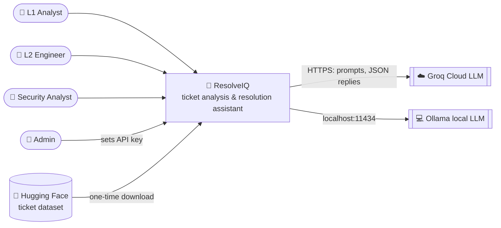
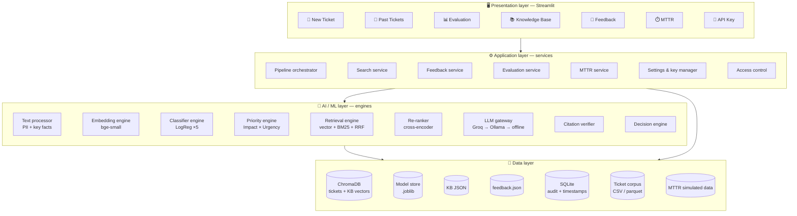
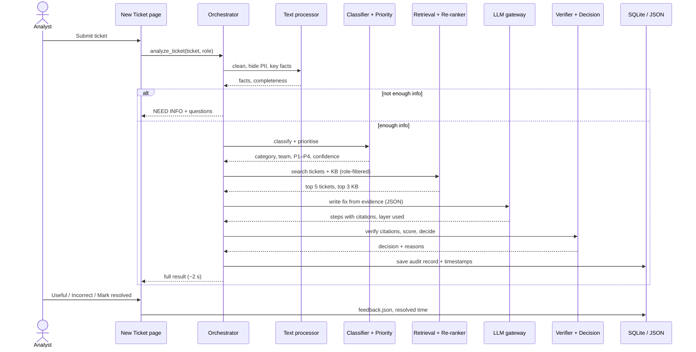
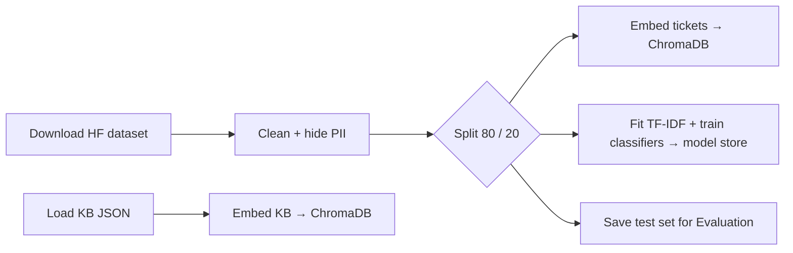
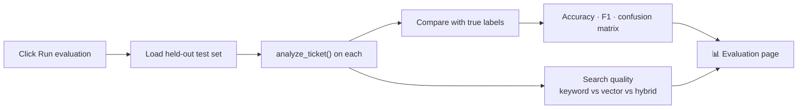
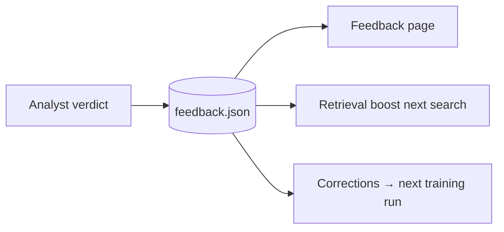
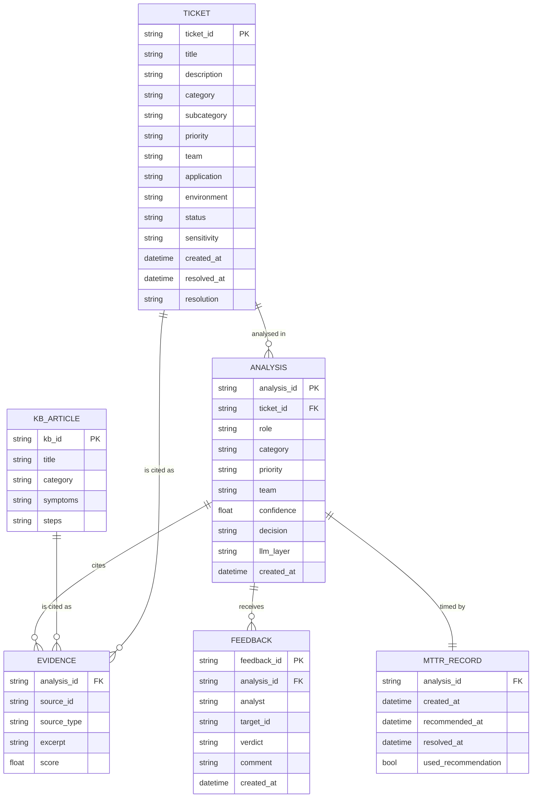
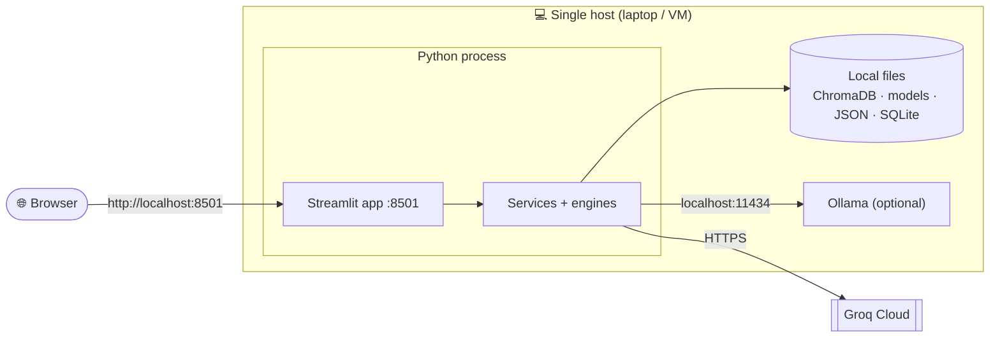

# ResolveIQ — High-Level Design (HLD)

*Intelligent IT Ticket Analysis & Resolution Assistant · HCLTech hackathon*

| Item | Value |
|---|---|
| Purpose | Analyse incoming IT tickets, find similar past cases, recommend an evidence-backed fix, cut MTTR |
| Scope | Analyse + recommend only. No auto-closure, no system changes, no production ITSM writes |
| Users | L1 Analyst · L2 Engineer · Security Analyst · Admin (sets API key) |
| Deployment | Single machine (laptop / VM), Streamlit app, local data stores, optional cloud LLM |

---

## 1. System context

Who and what the system talks to.

| External system | Direction | Data exchanged | If unavailable |
|---|---|---|---|
| Groq Cloud | outbound HTTPS | redacted ticket + evidence → JSON fix | fall back to Ollama |
| Ollama (local) | localhost | same as Groq | fall back to offline mode |
| Hugging Face | one-time download | ticket corpus | use cached copy in `data/` |

---

## 2. Layered architecture

**Layer rules**
- Pages call **services only** (never models or files directly), so the UI stays thin and the same services serve the evaluation and any API.
- Services call **engines**; engines are stateless functions with typed inputs and outputs (pydantic).
- Only the **data layer** touches disk; only the **LLM gateway** talks to the network.

---

## 3. Components

### 3.1 Presentation layer
| Page | Responsibility | Calls |
|---|---|---|
| 🎫 New Ticket | input form, show decision, classification, similar tickets, cited fix, confidence, trace, feedback buttons | Pipeline orchestrator, Feedback service |
| 📁 Past Tickets | browse and filter the corpus (app, category, priority, status, team, date) | Search service |
| 📊 Evaluation | run the test set; show confusion matrices, retrieval comparison, failed cases | Evaluation service |
| 📚 Knowledge Base | browse and search KB articles; see which tickets cited each one | Search service |
| 💬 Feedback | feedback per analyst and per article; totals | Feedback service |
| ⏱️ MTTR | baseline vs assisted MTTR by priority and category | MTTR service |
| 🔑 API Key | enter or test Groq key, choose model, see active LLM layer | Settings & key manager |

### 3.2 Application layer
| Service | Responsibility | Key interface |
|---|---|---|
| Pipeline orchestrator | runs the 5 stages in order, times each, builds the result and audit record | `analyze_ticket(ticket, role) → AnalysisResult` |
| Search service | filtered listing and search of tickets and KB | `search(query, filters, role) → list` |
| Feedback service | read and write `feedback.json`; aggregate per analyst and per item | `add_feedback(item)`, `get_feedback(analyst?)` |
| Evaluation service | run the pipeline on the test set and compute metrics | `run_evaluation() → EvalReport` |
| MTTR service | compute baseline and assisted MTTR from timestamps | `get_mttr(filters) → MTTRReport` |
| Settings & key manager | hold API key in session or `.env`, test the connection, pick the layer | `set_key(k)`, `test_connection()`, `active_layer()` |
| Access control | map role → visible sensitivity levels; mask exports | `allowed_levels(role)`, `mask(record, role)` |

### 3.3 AI / ML layer
| Engine | What it does | Technology | Output |
|---|---|---|---|
| Text processor | clean text, hide PII, extract key facts, completeness check | regex + word lists | clean text, facts, completeness |
| Embedding engine | text → 384-number vector | `bge-small-en-v1.5` (sentence-transformers) | vector |
| Classifier engine | category, subcategory, team, impact, urgency + probabilities; LLM adjudication when unsure | scikit-learn logistic regression (calibrated) + LLM gateway | labels + confidence |
| Priority engine | rules + ML → take higher → Impact × Urgency matrix | Python rules + matrix in YAML | P1–P4 + reason |
| Retrieval engine | role filter → vector search + keyword search → RRF merge → metadata boost | ChromaDB + `rank-bm25` | top-20 candidates |
| Re-ranker | re-score top 20 reading ticket + candidate together | cross-encoder `ms-marco-MiniLM-L-6-v2` | top 5 tickets, top 3 KB |
| LLM gateway | single entry point to any LLM with failover and timeouts | Groq SDK, Ollama HTTP, offline template | JSON reply + layer used |
| Citation verifier | drop steps citing unknown sources or misquoting them | ID check + `rapidfuzz` | verified steps + % valid |
| Decision engine | confidence from 5 signals; ordered rules | Python | RECOMMEND / REVIEW / ESCALATE / NEED INFO |

### 3.4 Data layer
| Store | Contents | Written by | Read by |
|---|---|---|---|
| Ticket corpus (CSV / parquet) | Hugging Face tickets, split train / test | setup | setup, Past Tickets |
| ChromaDB | vectors + metadata for tickets and KB articles | setup | Retrieval engine |
| Model store | vectoriser + trained classifiers (`.joblib`) | setup | Classifier engine |
| KB JSON | runbooks: id, title, symptoms, steps, category | team (curated) | Retrieval, KB page |
| `feedback.json` | analyst, ticket / article id, verdict, comment, time | Feedback service | Feedback page, retrieval boost |
| SQLite | audit records, created / recommended / resolved timestamps | Pipeline orchestrator | MTTR, audit export |
| MTTR simulated data | historical resolution times (labelled simulated) | setup | MTTR service |

---

## 4. Key flows

### 4.1 Analyse a ticket (main flow)

### 4.2 Setup (run once)

### 4.3 Evaluation run

### 4.4 Feedback loop

---

## 5. Data model

---

## 6. Deployment view

- One process, no external database server: starts with `streamlit run app/app.py`.
- Models load once at start-up and are cached (`st.cache_resource`).
- Only outbound call: Groq over HTTPS (optional).

---

## 7. Non-functional design

| Quality | Target / approach |
|---|---|
| **Performance** | under 2 s per ticket on Groq, under 0.5 s offline; search ~250 ms; models cached in memory |
| **Reliability** | LLM failover Groq → Ollama → offline; timeouts on every LLM call; JSON validated with one repair retry |
| **Security** | PII hidden before search, LLM and export; role-based filtering **before** search; API key masked, never logged, kept in session or `.env` (git-ignored) |
| **Explainability** | every label has confidence + reason; every match has "why matched"; every step has a checked citation; pipeline trace per ticket |
| **Safety** | low confidence or conflicting evidence → REVIEW / ESCALATE / NEED INFO; human always decides |
| **Auditability** | one record per analysis: input, predictions, evidence, fix, decision, reviewer verdict, timestamps |
| **Scalability path** | ChromaDB → managed vector DB; Streamlit → FastAPI + web UI; SQLite → Postgres; same service interfaces |
| **Observability** | per-stage latency and LLM layer recorded; shown in the trace and audit log |

---

## 8. Design decisions & trade-offs

| Decision | Chosen | Alternative | Why |
|---|---|---|---|
| Classification | ML models, LLM only when unsure | LLM for every ticket | fast (~10 ms), cheap, measurable, calibrated confidence |
| Search | vector + keyword + re-rank | vector only | vectors blur exact error codes; re-rank removes look-alikes |
| Fix source | KB articles only, cited and verified | free LLM answer | prevents made-up commands |
| Priority | ITIL Impact × Urgency, take higher | single ML priority | explainable; never under-prioritise P1 |
| LLM | Groq with Ollama + offline fallback | single provider | demo never fails |
| Storage | ChromaDB + JSON + SQLite | Postgres + vector service | zero setup, enough for this data size |
| UI | Streamlit | React | fastest to a working dashboard in Python |

---

## 9. Risks & mitigations

| Risk | Mitigation |
|---|---|
| Dataset labels are noisy | report per-class metrics; confusion matrix shows where; analyst corrections become new labels |
| No KB article covers a ticket | decision capped at REVIEW / ESCALATE; gap shown to analyst |
| LLM invents a step | citation verifier drops it |
| Groq outage or rate limit | automatic fallback to Ollama, then offline |
| Restricted data leaks | role filter applied before search; masked exports |
| MTTR data is simulated | labelled on the page; method and assumptions stated |
