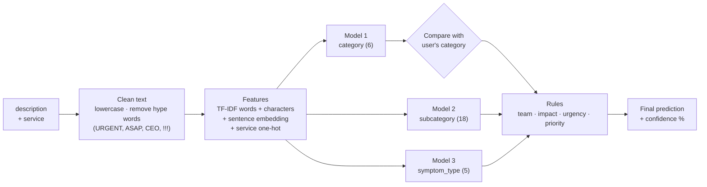

# ResolveIQ — ML Model Plan

How we train models that predict the answer fields of the curated ticket dataset (`DATA_GENERATION_PROMPT.md`).

---

## 1. What actually needs ML?

7 fields must be predicted, but only **3 need a model**. The rest follow fixed rules from the facts.

| Field | How it's predicted | Why |
|---|---|---|
| `category` | 🧠 **ML model** | must be read from the description |
| `subcategory` | 🧠 **ML model** | must be read from the description |
| `symptom_type` | 🧠 **ML model** | outage / blocked / slow / request / question: must be read from the description |
| `team` | 📏 rule | Security → Security · Account & Access → Service Desk · else the service's owner team |
| `impact` | 📏 rule | who_affected + service importance + predicted category & symptom_type |
| `urgency` | 📏 rule | predicted symptom_type + environment + busy dates |
| `priority` | 📏 rule | impact × urgency matrix |

**So the whole job is three text classifiers.** Everything else is a lookup, which is 100% explainable.

⚠️ **Priority depends on `symptom_type`.** A wrong symptom gives a wrong priority, so `symptom_type` is the model that matters most.

**Busy dates:** the ticket data has no timestamp, so the date is read from the description when one is written ("today is the 11th", via `src/text.find_date`), otherwise today's date is used for a live ticket.

---

## 2. Inputs to the models

| Input | Used? | Why |
|---|---|---|
| `description` | ✅ | the main signal |
| `service` | ✅ (one-hot) | narrows the category a lot (Printer → Device & Software) |
| `environment`, `who_affected` | ❌ for the classifiers | they drive impact and urgency rules, not the category |
| `user_category`, `user_subcategory` | ❌ **not a model input** | if the model sees them, it learns to copy them (they're right 80% of the time) and repeats the users' mistakes. We compare against them **after** prediction. |

---

## 3. Pipeline

### Step-by-step
1. **Clean:** lowercase; remove hype words (`urgent`, `asap`, `ceo`, `!!!`, ALL-CAPS shouting). This stops "URGENT" being read as `outage`.
2. **Features** (three kinds, side by side):
   - **TF-IDF on words** (1–2 word phrases): exact words like "printer", "locked", "503"
   - **TF-IDF on characters** (3–5 letters): survives typos ("pasword", "outlok")
   - **Sentence embedding** (`all-MiniLM-L6-v2`, 384 numbers; the same model the search uses): meaning, so "can't get in" ≈ "locked out"
   - **Service one-hot:** 14 yes/no columns
3. **Three logistic-regression models**, one per target, with balanced class weights.
4. **Subcategory must match category:** after predicting, keep only the subcategories that belong to the predicted category, then pick the best.
5. **Calibrate** each model so "0.80" means about 80% right (`CalibratedClassifierCV`).
6. **Compare with the user's pick** (category score = 0.6 × model + 0.2 × similar-ticket vote + 0.2 × user agrees): ≥ 0.75 accept, otherwise LLM tiebreak and REVIEW.
7. **Apply the rules** for team, impact, urgency and priority.

---

## 4. Training procedure

| Step | Detail |
|---|---|
| **Split** | 70% train · 15% validation · 15% test, **stratified by subcategory** so every class appears in each part. The test set is not touched until the end. |
| **Check the data first** | count per class; re-run the rules on every row and drop rows where team/impact/urgency/priority disagree with them (generator mistakes) |
| **Baselines** (to beat) | ① always guess the most common class · ② just trust the user's category (≈ 80%) |
| **Candidates** | ① TF-IDF only · ② embedding only · ③ TF-IDF + embedding + service |
| **Tuning** | 5-fold cross-validation on train for `C` ∈ {0.1, 1, 10} |
| **Choose** | the candidate with the best **macro-F1 on validation** (macro so small classes count equally) |
| **Thresholds** | tune the 0.75 acceptance threshold on validation |
| **Final test** | one run on the test set; these are the numbers we report |
| **Save** | the whole pipeline (cleaner + features + models) as one `.joblib` file |

---

## 5. How we measure it

| Check | Metric | Target |
|---|---|---|
| Category | accuracy, macro-F1, confusion matrix | beat "trust the user" (≈ 80%) |
| Subcategory | accuracy, macro-F1 | ≥ 80% |
| Symptom type | accuracy, macro-F1 | ≥ 85% (it drives priority) |
| **Priority (end-to-end)** | accuracy, confusion matrix | ≥ 85% |
| **Missed P1s** | % of true P1 predicted lower | as close to 0 as possible |
| **Hype test** | priority accuracy on hype tickets vs normal tickets | the same, so hype has no effect |
| **Wrong-user-category test** | % of wrong user picks the model corrects | as high as possible |
| Speed | time per ticket | < 50 ms |

Targets are goals until measured.

---

## 6. If results are weak

| Problem | Fix |
|---|---|
| category and subcategory confused | look at the confusion matrix; merge classes that are always mixed up, or add clearer examples |
| `symptom_type` weak | add simple cue features: "how do I" → question, "please install / need access" → request, "for everyone / nobody can" → outage |
| small classes poor | generate more examples for them |
| still weak | compare with an LLM classifying 100 test tickets; keep whichever is better (and report both) |

---

## 7. Files

| File | Does |
|---|---|
| `build/train_models.py` | load data → split → clean → features → train → tune → calibrate → save |
| `build/run_eval.py` | test-set metrics, confusion matrices, hype test, wrong-user-category test |
| `src/classify.py` | `predict(ticket) → {category, subcategory, symptom_type, probabilities}` |
| `src/rules.py` | team, impact, urgency, priority |
| `data/store/models/classifier.joblib` | the saved model |
