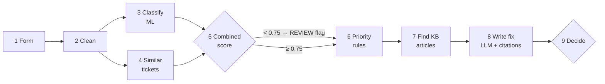

# ResolveIQ — Project Overview

*Start here. This one page explains what we're building, how every part works, how the parts connect, and where each requirement in the brief is met. The other docs go deeper on one topic each (§12).*

---

## 1. The problem in plain words

An IT help desk gets many tickets: passwords, broken apps, slow Wi-Fi, printers, security scares. For each one, an analyst has to:
1. work out **what kind of problem** it is and **how urgent** it is,
2. check whether it **has happened before**,
3. look up **how to fix it**.

Done by hand, this is slow and inconsistent, which pushes up **MTTR** (Mean Time To Resolve, the average time from ticket opened to ticket fixed).

**Goal from the brief:** an assistant that analyses a new ticket, finds similar past cases, and recommends a fix **backed by evidence**. A human analyst reviews it and acts. It must **measurably reduce MTTR**.

**What it must not do:** close tickets, change systems, or make claims it can't back up.

---

## 2. Our solution in one paragraph

**ResolveIQ** is a Streamlit app. Employees ask the knowledge base for self-help. Support staff fill in a short ticket form. **Machine-learning models** predict the category, subcategory and type of symptom. **Similar past tickets** act as a second opinion. If the system is unsure, an **LLM breaks the tie**. **Fixed rules** set the team and priority (P1–P4) from facts, never from tone. The system then searches **our knowledge base** for matching articles, and an **LLM writes a fix in which every step cites an article step**. Code checks each citation. Finally, **plain rules decide**: recommend it, ask a human to review it, escalate it, or ask the user for more information. Everything is logged for auditing and for measuring MTTR.



### Who does what (the most important table)

| Job | Done by | Why this choice |
|---|---|---|
| Category, subcategory, symptom type | 🧠 ML (logistic regression) | fast, cheap, measurable, gives a real probability |
| Second opinion | 🔎 similar past tickets | independent check from real history |
| Unsure classification (score < 0.75) | 👀 a human (REVIEW), shown the top 3 candidates | simpler and safer than a second LLM call; see §5 "Why no LLM tiebreak" |
| Team, impact, urgency, priority | 📏 rules + ITIL matrix | fully explainable; shouting "URGENT" can't change it |
| The fix | 🤖 LLM, writing **only** from KB articles, every step cited | readable, tailored, checkable |
| Final outcome | 📏 rules | predictable and auditable |

---

## 3. The data (curated by us)

We built our own dataset, so we control the labels and can include the hard cases on purpose. **All labels are generated, and we say so in the README and the evaluation report.**

| File | Made with | Size |
|---|---|---|
| `data/resolveiq_tickets.jsonl` | `Prompts/DATA_GENERATION_PROMPT.md` | 1,200 tickets |
| `data/knowledge_base/articles.json` | `Prompts/KB_GENERATION_PROMPT.md` | 55 articles (33 public, 22 internal) |

### A ticket
| The user fills in | The system predicts |
|---|---|
| `description`: free text | `category` (6) → `subcategory` (18) |
| `service`: 14 options, e.g. Email, VPN, Finance System, Printer | `symptom_type`: outage · blocked · slow · request · question |
| `environment`: Production · Test · Not applicable | `team`: Service Desk · Network · Applications · Desktop Support · Security |
| `who_affected`: Just me · My team · Many teams · Customers | `impact`, `urgency`: High · Medium · Low |
| `user_category`, `user_subcategory`: the user's guess | `priority`: P1 · P2 · P3 · P4 |

- **Trusted:** service, environment, who_affected. **Not trusted:** the tone of the description, and the user's own category.
- **Hard cases built in:**
  - **240 tickets (20%)** have a wrong user category. The model must correct it.
  - **65 tickets** contain hype that our filter detects ("URGENT!!!", "I'm getting heat from above"). Hype must not change the priority.
- **Taxonomy:**

  | Category | Subcategories |
  |---|---|
  | Account & Access | Password reset · Account locked · Need access |
  | Email & Communication | Email problem · Chat or video call problem · Calendar problem |
  | Network | VPN problem · Wi-Fi problem · Internet slow or down |
  | Business System | Error or won't open · Slow · Wrong data |
  | Device & Software | Computer problem · Printer problem · Phone problem · Install software |
  | Security | Suspicious email · Virus · Lost or stolen device |

### A KB article
Each article has a title, the subcategory and services it covers, **symptoms in the user's own words**, error messages, cause, **self-help steps** (for employees), **support steps** (for analysts, each with an expected result), how to verify the fix, when to escalate, and an `access_level` (public or internal).
Three problems have **no article on purpose**: wrong website prices, one employee's wrong pay, and blank prints on one floor. They test that the assistant escalates instead of guessing.

**Tickets have no "resolution" field.** So past tickets are used for *similarity* only, and **KB articles are the only source of fix steps**.

---

## 4. How a ticket flows, step by step

| # | Step | What happens | Example (ticket INC-00347 + hype, below) |
|---|---|---|---|
| 1 | **Form** | description + 5 dropdowns | — |
| 2 | **Clean** | hide personal data (emails, phones, IDs) · remove hype sentences · check enough detail was given | "I'm getting heat from above. Please pick this up immediately." → removed |
| 3 | **Classify** | 3 ML models read the cleaned text + service · subcategory is picked only from inside the predicted category | category *Business System* 0.97 · subcategory *Error or won't open* 0.97 · symptom *blocked* 0.60 |
| 4 | **Similar tickets** | vector search (meaning) + keyword search (exact words), merged · same service ranks a bit higher · vote = majority category of the top 5 | all 5 of the top 5 are *Business System* → vote agrees |
| 5 | **Combined score** | category score = `0.6 × model + 0.2 × (vote agrees) + 0.2 × (user agrees)` · **REVIEW flag** if the user disagrees, the score is < 0.75, or the security safety net fires | user picked *Device & Software* → 0.6×0.97 + 0.2×1 + 0 = **0.78** → flagged: "user chose 'Device & Software', model says 'Business System'" |
| 6 | **Priority** | team + impact + urgency rules → matrix → one-sentence reason | Applications · impact Medium (just me, critical service) × urgency High (blocked, production) = **P2** |
| 7 | **Find KB** | access filter by role → vector + keyword search → nudge same subcategory and service | KB-030 *"Payroll System is down for everyone after sign-in"* (the only article covering Payroll System), then KB-028, KB-029 (Finance System) |
| 8 | **Write fix** | LLM writes steps as JSON, each citing a step ID such as `KB-005/support/1` · code drops any step whose ID or wording doesn't match the source | 4 steps, all citing KB-030, e.g. "Review the Payroll System connection-pool health and dependency errors using request IDs" `[KB-030/support/2]` · citation validity 100% |
| 9 | **Decide** | rules, first match wins (§5) | **⬆️ ESCALATE** to Applications because it's P2, with the cited fix attached |

*Measured on a real run (Groq `openai/gpt-oss-120b`). INC-00347 is from the held-out test set, so it was never trained on or indexed and can't match itself as a "duplicate". Its original text has no hype; we added the first two sentences, exactly as the hype-injection test does.*

**The full ticket:**
> *"I'm getting heat from above. Please pick this up immediately. My workng salary application closes just after login. I can see the menu for a moment but can't open a run."*
> Service: Payroll System · Production · Just me · user's guess: Device & Software › Install software
> True answer: Business System › Error or won't open · blocked · Applications · **P2**

It shows four things at once:
- the hype is ignored,
- the wrong user category is corrected,
- the priority comes from facts,
- the fix is cited.

---

## 5. Confidence and fallback

**Confidence** (0–1) is the plain average of:
- the combined classification score (step 5),
- how well the best KB article matched (step 7),
- the share of fix steps that passed the citation check (step 8).

**Decision rules (first match wins):**

| # | If | Outcome | Meaning for the analyst |
|---|---|---|---|
| 1 | description too vague | ❓ NEED INFO | 1–2 questions to send back to the user |
| 2 | no KB article fits (**knowledge gap**), or no LLM is reachable | ⬆️ ESCALATE | hand to the predicted team; the gap is logged for Admin |
| 3 | priority P1 or P2 | ⬆️ ESCALATE | serious: a human owns it, with the fix attached to save time |
| 4 | the user's category disagreed, category score < 0.75, possible security issue, a more urgent symptom is plausible, top articles disagree, the ticket seems to hold two problems, or confidence < 0.6 | 👀 REVIEW | probably right, but check before acting |
| 5 | otherwise | ✅ RECOMMEND | evidence is strong and consistent |

Every outcome shows its reasons in words, e.g. *"REVIEW: user chose 'Device & Software', model says 'Account & Access'."*

**A knowledge gap** is found in one of three ways:
- nothing in the KB is close in meaning (best match < 0.20),
- **no article is written for this subcategory on this service** (e.g. "Wrong data" on Payroll System: a Finance "wrong data" article reads similar, but its steps don't apply), or
- the LLM reads the articles and says none really fits.

On the 180 test tickets, 36 (20%) are about a subcategory + service pair with no article. That is the KB's real coverage, and every one of them is listed for Admin as a gap to write.

**Symptom doubt:** if the second most likely symptom has ≥ 25% probability **and** would give a more urgent priority (e.g. "slow" P4 vs "blocked" P2), the ticket goes to REVIEW. Under-prioritising is the costly mistake, so only that direction is flagged.

**Two problems in one ticket:** "the VPN drops and separately my email stopped syncing" would otherwise get one confident fix for the VPN only. Each clause of the description is searched in the KB on its own (`Retriever.distinct_problems`); if two clauses match articles of **different subcategories at ≥ 50% similarity**, the ticket goes to REVIEW and the reason names both clauses. Measured: catches 5 of 6 hand-written two-problem tickets and fires on ~1% of one-problem tickets (`reports/RAG_EVALUATION.md` §5). We first tried running the classifier on each clause; it was trained on whole tickets, so short clauses gave weak predictions (1 of 6 caught).

**Why no LLM tiebreak:** an earlier design let an LLM choose between the top candidates when the category score was below 0.75. We dropped it: the ticket goes to REVIEW anyway, the analyst already sees the top 3 candidates with probabilities, and a second LLM call would add time and a second thing that can fail, without changing the outcome.

**LLM failover:** Groq (`openai/gpt-oss-120b`, cloud) → Ollama (`qwen2.5:3b`, local).
- If both fail when **writing the fix**: we ESCALATE with "LLM unavailable", and the similar tickets and articles are still shown.

There is no non-LLM fallback. The system never guesses.

**Security safety net:** missing a security incident costs far more than a false alarm. So a ticket is flagged "possible security issue: check with Security team" even when Security isn't the top guess, if any of these hold:
- the model gives Security ≥ 20%,
- the text contains a security cue,
- the user picked Security.

---

## 6. The app (Streamlit, 3 parts)

| Part | Who | What they do |
|---|---|---|
| 📚 **KB Assistant** | 👤 Employee | ask a question → self-help answer from **public** articles only, with citations. If nothing matches: *"Not in the knowledge base — please raise a ticket."* |
| 🎫 **Support Assistant** | 🎧 Support | **New ticket**: form → outcome, labels with confidence, priority reason, similar tickets, cited fix, step-by-step trace, feedback buttons (Useful · Incorrect · Unresolved), "mark resolved". **Past tickets**: browse and filter by service, category, subcategory, priority, team, environment |
| ⚙️ **Admin** | ⚙️ Admin | **Feedback** (per person / article, knowledge gaps, audit records + export) · **Evaluation** (metrics, confusion matrices) · **MTTR** (baseline vs assisted) · **Knowledge base** viewer · **Settings** (API key, masked) |

**Access rules (simple):**
- **Each role sees only its own pages.** No page is shared: the menu lists only that role's pages, and opening another role's page by URL is blocked.
- The KB Assistant uses public articles and self-help steps only. Internal articles and support steps appear only to Support (inside a ticket result) and to Admin (Knowledge base page).
- The article filter is applied **before** search, so restricted text never reaches the results or the LLM.
- Personal data is hidden before search, before the LLM and in exports.

---

## 7. Components and files

| Component | File | Status | Input → Output |
|---|---|---|---|
| Fixed lists (services, teams, taxonomy) | `src/taxonomy.py` | ✅ exists | — |
| Data contracts (pipeline ↔ dashboard) | `src/contracts.py` | ✅ exists | one `TypedDict` per step + `AnalysisResult` + `check_result()` |
| Text cleaner | `src/text.py` | ✅ exists | description → clean text, hype flag, dates |
| Features | `src/features.py` | ✅ exists | text + service → word/char TF-IDF + MiniLM vector + one-hot |
| Priority rules | `src/rules.py` | ✅ exists | facts + predicted labels → team, impact, urgency, priority, reason |
| Model training | `build/train_models.py` | ✅ exists | tickets → 3 calibrated models (`data/store/models/classifier.joblib`, not in git: rebuild it) |
| Classifier + combined score + review flags + security net | `src/classify.py` | ✅ exists | ticket + similar-ticket vote → labels, scores, priority + reason, review reasons |
| Classifier evaluation | `build/run_eval.py` | ✅ exists (search / fix / fallback metrics still to add) | test set → `reports/EVALUATION.md` + confusion-matrix PNGs |
| Index builder | `build/build_index.py` | ✅ exists | all non-test tickets + KB → ChromaDB |
| Retriever | `src/retrieve.py` | ✅ exists | query + role + filters → top 5 tickets / top 3 articles + signals |
| LLM gateway | `src/llm.py` | ✅ exists | prompt → JSON (Groq → Ollama) |
| Fix writer + citation check | `src/resolve.py` | ✅ exists | ticket + evidence → cited steps + validity |
| Decision | `src/decide.py` | ✅ exists | everything → outcome + reasons + confidence |
| Orchestrator | `src/pipeline.py` | ✅ exists (audit record still to add) | form → full result + timing trace |
| Storage | `src/store.py` | ⏳ | audit + timestamps (SQLite), feedback (JSON) |
| App | `app/app.py` | ⏳ | the 3 parts in §6 |

**Tech stack:** Python · scikit-learn · sentence-transformers (`all-MiniLM-L6-v2`) · ChromaDB · rank-bm25 · rapidfuzz · Groq SDK · Ollama · pydantic · SQLite · Streamlit. (`requirements.txt` currently lists only what the classifier needs; add the rest as each part is built.)

**How to run what exists today** (from the project root):
```bash
pip install -r requirements.txt
```
```bash
python -m build.train_models
```
```bash
python -m build.run_eval
```
```bash
python -m build.build_index
```
```bash
python -m build.run_rag_eval
```
```bash
python -m src.pipeline
```
The last one runs the demo ticket INC-00347 (held out, plus hype) end to end. Writing the fix needs `GROQ_API_KEY` in a `.env` file (fast) or Ollama running locally (slow on CPU).

---

## 8. How we prove it works (evaluation)

The test split is **15% of tickets, never seen in training or in the search index**.

| What | Metric | Answers the brief's question |
|---|---|---|
| Category / subcategory / symptom | accuracy, macro-F1, **confusion matrix** | "confusion between operationally important classes" |
| Priority | accuracy, confusion matrix, **missed P1s** | priority quality where it matters most |
| Hype test | priority accuracy on hype vs normal tickets | tone doesn't change priority |
| Wrong-category test | % of wrong user picks we correct | better than trusting the user |
| Baselines | most common class · "trust the user" | proves the ML adds value |
| Similar tickets | Recall@5, MRR, for **keyword vs vector vs hybrid** | "related tickets near the top, not superficial keyword matches" |
| KB search | Hit@1 / Hit@3 on 50 hand-labelled test tickets | right article found |
| Faithfulness | average citation validity | "supported by source evidence" |
| Fallback | 17 probe tickets (3 uncovered problems, 3 vague, 3 off-topic, 2 contradictory fields, 2 two-problem, 2 hidden security, 2 wrong user category) → % sent to a human | "weak or contradictory evidence → escalation" |
| Usefulness | ≥ 3 worked examples reviewed by hand | "relevant, actionable" |
| MTTR | baseline vs assisted (§9) | the core business goal |

### First measured results (`reports/EVALUATION.md`, classifier + rules only)

| Check | Result |
|---|---|
| Category accuracy | **96.1%** vs 80.6% for "trust the user" |
| Subcategory / symptom type accuracy | 94.4% / 97.2% |
| Priority accuracy (end to end) | **98.9%** |
| P1s missed | 2 of 16, both Security tickets, both still flagged for review |
| Hype | priority unchanged on 100% of tickets after adding "I'm the CEO, fix this now" |
| Wrong user category | corrected 35 / 35 |
| Sent to REVIEW | 29% of tickets |
| Speed | ~129 ms per ticket (classification + rules) |

Search, fix-writing and fallback metrics come next. Other targets are goals until measured. We report failures and limitations honestly.

---

## 9. MTTR measurement (FR-09)

- **Assisted:** every analysis stores `created_at` (submitted), `recommended_at` (result shown) and `resolved_at` (analyst clicks "mark resolved") in SQLite.
- **Baseline (manual):** our data has no real history, so we use **simulated** manual handling times per priority, clearly labelled as simulated, with the assumption written down.
- **Admin › MTTR** shows both, split by priority and category.

---

## 10. Problem-statement coverage (every item in the brief)

### Functional requirements
| ID | Requirement | How we meet it | Where |
|---|---|---|---|
| FR-01 | category, subcategory, priority or intent + confidence | ML for category/subcategory, **symptom_type = intent**, rules for priority; combined score + calibrated probabilities shown | steps 3, 5, 6 |
| FR-02 | similar tickets using title, description, symptoms, service, metadata | hybrid search on cleaned description (our form has no title, by design) + service boost + metadata filters; duplicate flag above a score threshold | step 4 |
| FR-03 | resolution from resolved cases or approved knowledge | LLM writes 1+ paths from KB articles only | steps 7–8 |
| FR-04 | source, excerpt, reason | step ID + quoted text + `why_matched` + "why it fits"; similar tickets shown with their scores | steps 4, 7, 8 |
| FR-05 | flag low confidence, no unsupported claims, human path | confidence, low score → REVIEW, symptom doubt → REVIEW, citation check, 4 outcomes, knowledge-gap escalation | §5 |
| FR-06 | mark useful / incorrect / unresolved | buttons on every match and fix → `feedback.json` | New ticket page |
| FR-07 | filters (application, category, date, status, group, environment) | service, category, subcategory, priority, team, environment (**date and status are not in our data**, which the brief allows: "where the seed data permits") | Past tickets page, search |
| FR-08 | audit: input, prediction, evidence, recommendation, reviewer decision | one SQLite record per analysis + feedback, exportable as CSV/JSON with personal data hidden | `src/store.py` |
| FR-09 | timestamps, MTTR vs manual baseline | §9 | Admin › MTTR |

### Expected submission
| Deliverable | Our output |
|---|---|
| 1. Working prototype | Streamlit app (§6), runs end to end on our data |
| 2. Evaluation report | `reports/EVALUATION.md` from `build/run_eval.py`: dataset · method · results · errors · limitations (classifier part done) |
| 3. ≥ 3 worked examples | `reports/EXAMPLES.md`, generated from real runs (INC-00347 above is one) |
| 4. README | setup + run, architecture summary (this doc), assumptions, trade-offs |

### Evaluation guidance (how judges score)
| Dimension | Our evidence |
|---|---|
| Classification quality | per-class F1 + confusion matrices + missed P1s + baselines |
| Duplicate retrieval quality | keyword vs vector vs hybrid table |
| Resolution usefulness | analyst feedback + worked examples + citation validity |
| Confidence and fallback | probe-ticket test + decision rules |
| Traceability | every label has a score/reason; every step has a checked citation; audit log |

### Scope boundaries
| Boundary | How we respect it |
|---|---|
| analyse and recommend only | no closing, no system changes; a human decides |
| rules / ML / retrieval / GenAI allowed if explainable | each step says what it used and why |
| synthetic data allowed; generated labels identified | stated in the README, the report and §3 |
| sensitive content and access respected | personal data hidden; access filter before search; masked exports |

---

## 11. Assumptions and limitations

| Assumption / limitation | Why it's acceptable |
|---|---|
| Data is synthetic, so real tickets will be messier | hard cases built in; the report states it |
| No title, date or status fields | form designed without them; FR-07 allows "where the data permits" |
| "Duplicate" means "same problem seen before", not "same live incident" | no timestamps in the data |
| MTTR baseline is simulated | labelled everywhere |
| Needs Groq or Ollama to produce a fix | without them the system escalates; it never guesses |
| KB of 55 articles | covers all 18 subcategories; gaps are escalated and logged |

---

## 12. Document map

| Doc | Read it for |
|---|---|
| **`Docs/PROJECT_OVERVIEW.md`** (this) | the whole picture + brief coverage |
| `Docs/HLD.md` | layers, components, data model, flows, trade-offs |
| `Docs/ML_PLAN.md` | how the classifiers are built and measured |
| `Docs/RAG_PLAN.md` | how search, fix writing and citation checks work |
| `reports/EVALUATION.md` | measured results |
| `Problem Statement/PROBLEM_STATEMENT.md` | the original brief |
| `Prompts/*.md` | how the dataset and KB were generated |

---

## 13. Responsible AI

- Personal data is hidden before search, before the LLM and in exports.
- Role-based access: internal articles and support steps never reach employees.
- Every label has a score and a reason. Every fix step has a checked citation.
- Low confidence, disagreement or a possible security issue → a human reviews it. The system never makes a confident guess.
- Human in the loop: the analyst decides, and the system never acts on systems or tickets.
- Generated labels and simulated MTTR data are labelled as such.

---

## 14. Demo script (5 min)

1. **New ticket INC-00347 + hype** (held-out): hype ignored, wrong user category corrected, P2 from facts, cited fix → ESCALATE to Applications.
2. **Calm vs hype**: the same printer ticket with and without "URGENT, I'm the CEO" → same priority.
3. **Vague ticket** ("system not working") → NEED INFO with questions.
4. **Uncovered problem** ("customers see the wrong prices on the website") → knowledge gap → ESCALATE.
5. **Evaluation**: confusion matrices + keyword vs hybrid search table.
6. **Admin**: feedback per analyst; MTTR baseline vs assisted.

---

## 15. Add-ons (only after the core works)

- **Incident storm alert:** many similar tickets on one service → "possible major incident".
- **Two-problem tickets:** "VPN drops and email won't sync" → handle both.
- **Feedback boost:** articles marked Useful rank slightly higher next time.
- **Queue page:** triage a batch of tickets at once.

---

## 16. Glossary

| Term | Meaning |
|---|---|
| **MTTR** | Mean Time To Resolve: average time from ticket opened to fixed |
| **ITIL Impact × Urgency** | standard help-desk grid: how many are affected × how fast it's needed → P1–P4 |
| **Logistic regression** | a simple, fast ML model that gives a probability for each label |
| **Calibrated** | "0.80" really means right about 80% of the time |
| **TF-IDF** | turns text into word-importance numbers, good at exact words |
| **Embedding** | turns text into numbers by *meaning*, so "can't get in" ≈ "locked out" |
| **BM25** | classic keyword search |
| **Hybrid search / RRF** | run keyword + meaning search, merge by rank (Reciprocal Rank Fusion) |
| **RAG** | Retrieval-Augmented Generation: find sources first, then let the LLM write *only* from them |
| **Citation check** | code verifying each fix step really comes from the article it cites |
| **Knowledge gap** | a ticket with no matching article, logged so someone can write one |
| **Hype** | pressure words ("URGENT", "I'm the CEO") that must not affect priority |
