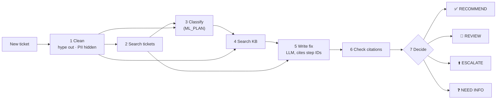

# ResolveIQ — RAG Pipeline Plan

How we find evidence and turn it into a cited fix. Companion to `ML_PLAN.md`: that file **labels** the ticket, this one **resolves** it.

---

## 1. The idea in one picture

Our data decides the design:

| Source | Size | Has a fix? | Used for |
|---|---|---|---|
| Tickets (`resolveiq_tickets.jsonl`) | 1,200 | ❌ no resolution field | **similar cases**: duplicates + a "past tickets vote" |
| KB articles (`articles.json`) | 55, all subcategories covered | ✅ steps | **the only source of fix steps** |

> Tickets say *"this happened before"*. KB articles say *"here is how to fix it"*. The LLM may only cite KB steps.



**Why this order:** tickets are searched *before* classifying, so their vote is an independent second opinion. KB is searched *after*, so it can use the predicted subcategory as a hint.

---

## 2. Build the indexes (once, `build/build_index.py`)

| What | Text that is searched | Metadata (for filters / boosts) |
|---|---|---|
| **Tickets**: 1 entry per ticket, **train split only** (otherwise test tickets find themselves) | `clean_description(description)` | service, environment, category, subcategory, priority, team |
| **KB**: 1 entry per article | **match card** = title + symptoms + error messages + keywords | kb_id, subcategory, services, access_level |

- The **steps are not searched**. Users describe symptoms, not fixes, so only the match card is indexed and the full article is fetched after a hit.
- Each step gets an ID when indexed: `KB-020/support/1`, `KB-020/self/2`. The LLM cites these, and the checker verifies them.
- **Tools:** `all-MiniLM-L6-v2` embeddings (the same model the classifier uses in `src/features.py`, loaded once) · ChromaDB (two collections) · `rank-bm25` for keywords.

---

## 3. Search (`src/retrieve.py`): same recipe for both sources

> **Update after measuring (`reports/RAG_EVALUATION.md`, 180 held-out tickets):** meaning search alone beat hybrid (similar tickets MRR 0.955 vs 0.917 · KB Hit@3 with hint 93.9% vs 89.4%). Our tickets are paraphrased, so exact-word matches mostly added noise. **Default is now `SEARCH_MODE = "vector"`**; keyword + RRF stays in the code for the comparison table and is one constant away.

1. **Filter** (hard): role → allowed `access_level` (KB only) + any filters the user picked (FR-07).
2. **Meaning search** (vectors, top 20) + **keyword search** (BM25, top 20).
3. **Merge** with RRF: `score = 1/(60 + rank_vector) + 1/(60 + rank_keyword)`. A result high on both lists wins, and there are no score scales to tune.
4. **Boost** (soft, small):
   - tickets: `× 1.15` if same service
   - KB: `× (1 + 0.2 × classifier probability)` if same predicted subcategory, `× 1.1` if service matches
5. Keep **top 5 tickets** and **top 3 articles**, each with a `why_matched` line built from what actually fired (e.g. *"same service VPN · subcategory VPN problem (87%)"*).

**Rules we stick to**
- Predicted labels only **boost**, never filter, so a wrong prediction can't hide the right article.
- Ticket boosts use only facts the user gave (service), so the ticket vote stays independent of the classifier.

**Signals passed on** to step 7:
- `kb_best`: the score of the #1 article
- `conflict`: #1 and #2 are close but in different subcategories
- `agree`: the classifier, the #1 article and the ticket vote name the same subcategory

**Duplicate flag:** a similar ticket above a tuned score is shown as "possible duplicate". Assumption: there are no timestamps, so this means "same problem", not "same live incident".

---

## 4. Write the fix (`src/resolve.py` + `src/llm.py`)

**LLM gets:** cleaned ticket + facts, the predicted labels, the top 3 articles with step IDs, and the top 5 tickets marked *context only*. Analysts see support + self-help steps. Employees (KB Assistant) see public articles, self-help steps only.

**LLM returns JSON:**
```json
{"paths": [{"kb_id": "KB-020",
            "why_it_fits": "VPN is connected but the shared drive won't open — matches symptom 1.",
            "steps": [{"text": "...", "cites": ["KB-020/support/1"]}]}],
 "insufficient_evidence": false,
 "clarifying_questions": []}
```

**Failover:** Groq → Ollama. There is no non-LLM fallback. If both fail, the decision is ⬆️ ESCALATE ("LLM unavailable"), and the similar tickets and articles found are still shown as evidence.

---

## 5. Check citations

For each step: the cited ID must be one we retrieved **and** the text must still match the source (`rapidfuzz` ≥ 70). Otherwise the step is dropped.
`citation_validity = steps kept / steps written`.

This makes "no unsupported conclusions" (FR-05) a code check, not a hope.

---

## 6. Decide (`src/decide.py`)

**Confidence** = average of three numbers: combined classification score (`ML_PLAN.md` step 6), `kb_best`, `citation_validity`. No weights to tune or defend.

**Rules (first match wins):**

| # | If | Then |
|---|---|---|
| 0 | both LLMs (Groq and Ollama) failed | ⬆️ ESCALATE: "LLM unavailable" |
| 1 | too little detail, or the LLM asked questions | ❓ NEED INFO |
| 2 | `kb_best` < 0.20 (clearly unrelated) **or** the LLM says no article fits (`insufficient_evidence`) | ⬆️ ESCALATE: logged as a **knowledge gap** |
| 3 | priority P1 / P2 | ⬆️ ESCALATE (fix still shown to help the engineer) |
| 4 | LLM tiebreak was needed, `conflict`, sources don't `agree`, or confidence < 0.6 | 👀 REVIEW |
| 5 | otherwise | ✅ RECOMMEND |

Every outcome shows its reason in words. Each run also saves one audit record (input, labels, evidence, fix, decision) for FR-08.

---

## 7. Feedback (FR-06)

The analyst marks each match / fix as **Useful · Incorrect · Unresolved** → saved to `feedback.json` and shown on the Admin page. "Unresolved" also counts as a knowledge gap.
*Add-on if time allows:* use the votes as a small search boost.

---

## 8. KB Assistant reuses all of this

Question → step 4 (public only) → step 5 (self-help only) → step 6 → if `kb_best` is low: *"Not in the knowledge base — please raise a ticket."* Nothing new to build.

---

## 9. Evaluation

| Check | How | Metric |
|---|---|---|
| **Similar tickets** | test tickets searched against the train index; "relevant" = same subcategory | Recall@5, MRR |
| **Not just keywords** | same test, 3 setups: keyword only · vectors only · hybrid | one comparison table |
| **KB search** | 50 test tickets: the script shows the ≤4 articles in the same subcategory, **you pick the right one** (or "none"). Hand-labelled, so stated in the report | Hit@1, Hit@3 |
| **No made-up steps** | full test run | average `citation_validity` |
| **Fallback** | 15 hand-written probe tickets: off-topic, vague, two problems | % sent to a human (target: all) |
| **Worked examples** | 3+ tickets end to end (deliverable 3) | relevant / actionable / cited, yes or no |

---

## 10. Files (all built ✅)

| File | Does |
|---|---|
| `build/build_index.py` | clean → embed → ChromaDB (`tickets`, `kb_articles`); BM25 is rebuilt in memory on load |
| `src/kb.py` | load articles, match cards, step IDs, role → access rules |
| `src/retrieve.py` | `search_tickets()`, `search_kb()` → hits + vote + signals |
| `src/llm.py` | Groq → Ollama over plain HTTP (timeouts, one JSON retry) |
| `src/resolve.py` | prompt, JSON, citation check |
| `src/decide.py` | confidence + rules |
| `src/pipeline.py` | `analyze_ticket()` (all steps + timing trace), `ask_kb()` for the KB Assistant |
| `build/run_rag_eval.py` | §9 metrics → `reports/RAG_EVALUATION.md` (`--llm N` adds the full pipeline + probes) |

**Output shape:** `analyze_ticket()` returns `contracts.AnalysisResult` and `ask_kb()` returns `contracts.KBAnswer` (`src/contracts.py`), so the dashboard reads the same field names the pipeline writes. Run `python -m src.pipeline` to see one full result plus `check_result()`.

**Built-in robustness (each one found while testing):**
- **PII is hidden first** (`text.mask_pii`: emails, phone numbers, employee IDs), before search, the LLM (Groq is a cloud service) and the UI. It changes none of the 1,200 dataset tickets, so classifier accuracy is unaffected.
- **Too vague → no LLM call.** A small model invented an irrelevant question ("What type of monitor…?"), so code asks two fixed questions instead.
- **Malformed LLM JSON** (e.g. `paths` as a list of strings) counts as dropped steps, never a crash.

**Why the knowledge-gap rule uses the LLM:** the best-match score alone can't separate gaps from normal tickets (5% of normal test tickets score below 0.20, while the uncovered "blank prints on one floor" scores 0.47 because it *looks* like a printer article). So code catches the obvious cases and the LLM, which reads the cause and conditions, catches the rest.

## 11. Trade-offs (for the README)

| Chose | Over | Why |
|---|---|---|
| Fix steps only from KB | ticket resolutions | tickets have none; KB = "approved knowledge" |
| Index symptoms, not steps | whole article | users describe symptoms |
| Vector search (measured) | hybrid | on our paraphrased tickets hybrid scored lower; the comparison table shows it, and hybrid is one constant away |
| Labels as boosts | labels as filters | a wrong label can't hide the answer |
| Simple average confidence | tuned weights | easy to explain and defend |
| No re-ranker (yet) | cross-encoder | 55 articles; add it only if the eval shows a gap |
