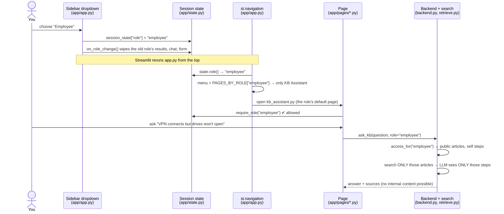

# Role-based access in ResolveIQ

> **In one line:** ResolveIQ has three roles (Employee, Support, Admin). The role decides which pages you see
> and which knowledge-base content can reach you. It's checked in four places, the strongest one being
> *before* the search runs. **There is no login yet.** For the demo, the role comes from a dropdown.

---

## 1. The three roles

| Role | Who it stands for | Pages | KB articles it can see | KB steps it can see |
|---|---|---|---|---|
| 👤 **Employee** | Anyone in the company with an IT problem | 📚 KB Assistant | `public` only (33 of 55) | Self-help steps only |
| 🎧 **Support** | Service-desk analyst | 🎫 New ticket · 📁 Past tickets | `public` + `internal` (all 55) | Self-help + support steps |
| ⚙️ **Admin** | Team lead / system owner | 💬 Feedback & audit · 📊 Evaluation · ⏱️ MTTR · 📚 Knowledge base · 🔑 Settings | `public` + `internal` (all 55) | Self-help + support steps |

Two things to notice:
- **No page is shared.** Admin can't open New ticket, and Support can't open Settings. Each role does its own job.
- **Every KB article has an `access_level`** (`public` or `internal`). **Every step has a type**:
  `self` (safe for the user to do, e.g. "restart the VPN client") or `support` (needs admin rights,
  e.g. "unlock the account in AD"). Employees only ever get `public` articles and `self` steps.

---

## 2. What happens when you pick a role in the dropdown

The sidebar has a **"Viewing as"** dropdown and a **"Your name"** box. Here is what happens, step by step,
when you change the dropdown from *Support* to *Employee*:



The same flow, in words:

1. **The dropdown writes the role into session state.** The selectbox has `key="role"`, so Streamlit stores
   your choice in `st.session_state["role"]`. Session state is memory that lives as long as your browser tab,
   one copy per user.
2. **A cleanup runs.** The dropdown has `on_change=state.on_role_change`. This runs *before* the page
   redraws and deletes everything the previous role was working on: the analysis result, the chat history,
   the form, and any key starting with `fb_`, `nt_`, `kb_`, `pt_` or `au_`. So an Employee never sees a
   Support analyst's half-finished ticket left on screen.
3. **Streamlit reruns the app from the top.** That's how Streamlit works: every interaction reruns
   `app/app.py` top to bottom.
4. **The menu is rebuilt for the new role.** `st.navigation(PAGES_BY_ROLE[state.role()])` registers *only*
   that role's pages. Other roles' pages don't exist in this run, not even as hidden links. If you were on
   a page the new role doesn't have, Streamlit sends you to the role's default page.
5. **The page checks the role again.** The first line of every page is `state.require_role(...)`. If the
   role doesn't match, it shows "This page isn't available for your role." and stops.
6. **The role travels with every data request.** Pages pass `state.role()` to the backend
   (`analyze_ticket(ticket, role, …)`, `ask_kb(question, role="employee")`, `list_tickets(…, role)`,
   `list_kb(…, role)`). The search and data code filters on it (see §3, layers 3 and 4).
7. **The role is saved in the audit log.** Every analysis is stored with `analyst` (the "Your name" box) and
   `role`, so the Admin's Feedback & audit page can show *who* ran *what* as *which role*.

---

## 3. The four layers of checking

Each layer catches what the one before it might miss.

| # | Layer | Where | What it stops |
|---|---|---|---|
| 1 | **Menu** | `PAGES_BY_ROLE` in [`app/app.py`](../app/app.py) | Other roles' pages never appear in the sidebar |
| 2 | **Page guard** | `require_role()` in [`app/state.py`](../app/state.py), called at the top of every page | Opening another role's page by typing its URL |
| 3 | **Data access** | `ROLE_ACCESS` / `access_for()` in [`src/kb.py`](../src/kb.py); `list_tickets()` in [`app/backend.py`](../app/backend.py) | Internal articles and support steps reaching an Employee; Employees reading past tickets (`PermissionError`) |
| 4 | **Citation check** | `check_citations()` in [`src/resolve.py`](../src/resolve.py) | The LLM making up a step it wasn't shown: any step citing an ID outside the allowed list is dropped |

### Why layer 3 matters most: filter *before* search

The role table lives in one place:

```python
# src/kb.py
ROLE_ACCESS = {
    "employee": {"levels": ["public"],             "step_types": ["self"]},
    "support":  {"levels": ["public", "internal"], "step_types": ["self", "support"]},
    "admin":    {"levels": ["public", "internal"], "step_types": ["self", "support"]},
}
```

`search_kb()` in [`src/retrieve.py`](../src/retrieve.py) uses it **inside the search itself**:
- The vector search (ChromaDB) gets a filter, `where={"access_level": {"$in": levels}}`, so internal
  articles are never candidates.
- The keyword search gets the same rule as `allowed=lambda m: m["access_level"] in levels`.
- The steps attached to each result go through `article_steps(article, step_types)`, so an Employee's copy of
  an article has no support steps at all.

Hiding results *after* search would not be enough in a RAG system. If an internal article were found and then
hidden from the screen, its text would still have gone into the **LLM prompt**, and the model could repeat it in
the answer. Filtering first means restricted text never reaches the ranking, the results, the prompt or the
answer.

---

## 4. What this is not (yet): there's no login

| | Today | Real deployment |
|---|---|---|
| **Authentication** (who are you?) | ❌ None. Anyone picks any role from the dropdown. The sidebar says *"Demo role switch — no real sign-in"*. | A sign-in (company SSO, or `st.login()` with OIDC in Streamlit ≥ 1.42), with the role taken from the user's group, not chosen by them |
| **Authorization** (what may you do?) | ✅ Built and enforced in four layers (§3) | Unchanged |

**Why it's a dropdown:** in a demo, judges need to switch between the Employee, Support and Admin views
in seconds. A login per role would slow that down and add nothing the judges can see.

**What to watch out for while it's a dropdown:** anyone can choose Admin and open **Settings**, where the Groq API
key is entered. The key is shown masked (`gsk_••••abcd`) and is never logged, but a real deployment must put
Settings behind a real login.

**How small the upgrade is:** every check reads the role from one function, `state.role()`. Adding a login
means setting `st.session_state["role"]` from the signed-in user and removing the dropdown. Layers 1–4
stay exactly as they are.

---

## 5. Quick test (to show judges)

1. Pick **Employee** and ask *"my account keeps getting locked"*. The answer cites only `…/self/…` steps
   from KB-004 / KB-005, and the Sources expander lists only `public` articles.
2. Pick **Support** and analyse the same text on **New ticket**. The same articles now also carry their
   `…/support/…` steps (the admin-side unlock steps). If the ticket describes *everyone* being blocked from
   signing in, Support also gets KB-006, an `internal` article an Employee can never see.
3. While on **Employee**, paste the New ticket page URL into the address bar. You get *"This page isn't
   available for your role."*
4. Pick **Admin** and open **Feedback & audit**. Each stored analysis shows the analyst's name and the
   role it ran under.
