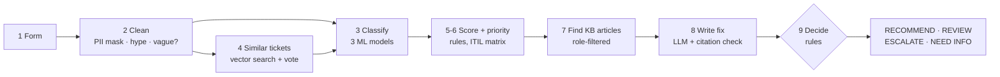

# ResolveIQ: Intelligent IT Ticket Analysis and Resolution Assistant

*HCLTech Future Ready AI Engineer Hackathon · Team RAGs to Riches*

ResolveIQ reads a new IT ticket, **classifies it**, finds **similar past tickets**, and recommends a fix in which
**every step cites an approved knowledge-base article**. A human analyst always makes the final call. The assistant
**analyses and recommends only**. It never closes tickets or touches systems.

| Brief deliverable | Where |
|---|---|
| 1. Working prototype | Streamlit app: `streamlit run app/app.py` (see [Run](#3-run-the-app)) |
| 2. Evaluation report | [`reports/EVALUATION.md`](reports/EVALUATION.md) (classifier + rules) · [`reports/RAG_EVALUATION.md`](reports/RAG_EVALUATION.md) (search, fix, fallback) |
| 3. ≥ 3 worked examples | [`reports/EXAMPLES.md`](reports/EXAMPLES.md) (6 real runs, covering all 4 outcomes) |
| 4. README | this file |

> **Data note:** all tickets, labels and KB articles are **synthetic, generated by us** (prompts in `Prompts/`).
> The MTTR baseline is **simulated**. Both are labelled as such in the app and the reports.

---

## 1. Results at a glance

Held-out test set: **180 tickets** (15%), never used in training or in the search index.

| What | Result | Compared with |
|---|---|---|
| Category accuracy | **96.1%** | 80.6% if we trusted the user's own pick |
| Subcategory / symptom type | **94.4% / 97.2%** | 10.6% / 43.9% for "always most common" |
| Priority (end to end, P1–P4) | **98.9%** | 2 of 16 P1s missed, both still sent to a human |
| Hype resistance | priority unchanged on **100%** of 168 tickets after adding *"I'm the CEO, fix this now"* | |
| Wrong user category | **35 / 35** corrected | |
| Similar tickets (vector search) | **Hit@5 100% · MRR 0.955** | keyword 0.862 · hybrid 0.917 |
| KB article search | **Hit@3 93.9%** (with classifier hint) | 83.9% without the hint |
| Citation validity of fixes | **100%** | every step is checked by code against the article it cites |
| Weak / contradictory tickets sent to a human | **17 / 17** | knowledge gap, vague, off-topic, contradictory, two problems, hidden security, wrong category |

---

## 2. Setup

Developed and tested on **Python 3.14** on Windows. Run every command from the project root.

**1. Create a virtual environment and install the dependencies**
```bash
python -m venv .venv
```
```bash
.venv\Scripts\activate
```
(macOS / Linux: `source .venv/bin/activate`)
```bash
pip install -r requirements.txt
```

**2. Download the sentence-embedding model once** (the code then runs offline with the cached copy)
```bash
python -c "from sentence_transformers import SentenceTransformer; SentenceTransformer('sentence-transformers/all-MiniLM-L6-v2')"
```

**3. Add an LLM key**: create a `.env` file in the project root (it's git-ignored):
```
GROQ_API_KEY=your-groq-key
GEMINI_API_KEY=your-gemini-key
```
At least one route is needed to *write fixes*. Everything else (classification, search, priority, decisions) works
without an LLM. Optional settings: `GROQ_API_KEY_SPARE_1…`, `GEMINI_API_KEY_SPARE_1…` (extra keys),
`GROQ_MODEL`, `GEMINI_MODELS`, `OLLAMA_MODEL` (default `qwen2.5:3b`), `OLLAMA_URL`. A key can also be entered in the
app under **Admin › Settings**.

**4. Build the models and the search index** (`data/store/` isn't in git, so a fresh clone must build it)
```bash
python -m build.train_models
```
```bash
python -m build.build_index
```

**5. (Optional) Seed demo records for the MTTR page**
```bash
python -m build.seed_mttr_demo
```
Remove them again with `python -m build.seed_mttr_demo --clear`.

---

## 3. Run the app

```bash
streamlit run app/app.py
```

Pick a role in the sidebar. This is a demo role switch, not real sign-in. Each role sees only its own pages:

| Role | Pages |
|---|---|
| 👤 Employee | **KB Assistant**: self-help answers from *public* articles only, with citations |
| 🎧 Support | **New ticket**: form → outcome, labels with confidence, priority reason, similar tickets, cited fix, step trace, feedback buttons, "mark resolved" · **Past tickets**: browse and filter |
| ⚙️ Admin | **Feedback** + audit export · **Evaluation** · **MTTR** (assisted vs simulated baseline) · **Knowledge base** · **Settings** |

**Try it:** as Support, paste the INC-00347 ticket from [`reports/EXAMPLES.md`](reports/EXAMPLES.md) §3. You'll see the
hype removed, the wrong user category corrected, P2 from facts, and a cited fix escalated to Applications.

**Without the UI:**
```bash
python -m src.pipeline
```
This runs the same demo ticket end to end and prints the result.

### Re-run the evaluation
```bash
python -m build.run_eval
```
```bash
python -m build.run_rag_eval --llm 10
```
```bash
python -m build.run_examples
```
These write `reports/EVALUATION.md` (+ confusion matrices), `reports/RAG_EVALUATION.md`, and
`reports/examples_results.json`. The `--llm 10` part runs the full pipeline on 10 test tickets + 17 probe tickets
and needs an LLM route.

---

## 4. Architecture



**Who does what**

| Job | Done by | Why |
|---|---|---|
| Category, subcategory, symptom type | 🧠 3 calibrated logistic-regression models on MiniLM embeddings + TF-IDF | fast (~0.15 s), measurable, real probabilities |
| Second opinion | 🔎 majority vote of the 5 most similar past tickets | independent evidence from history |
| Team, impact, urgency, priority | 📏 rules + ITIL impact × urgency matrix, from **facts** (service, environment, who is affected, symptom) | fully explainable; tone can't change it |
| The fix | 🤖 LLM writing **only** from retrieved KB articles; each step cites e.g. `KB-016/self/1` and code drops any step that doesn't match its source | readable, tailored, checkable |
| Final outcome | 📏 rules, first match wins | predictable and auditable |

**Decision rules**

| If | Outcome |
|---|---|
| description too vague | ❓ **NEED INFO**, with questions for the user |
| no KB article fits (knowledge gap) or no LLM reachable | ⬆️ **ESCALATE** to the predicted team; the gap is logged |
| priority P1 or P2 | ⬆️ **ESCALATE**, with the cited fix attached |
| user's category disagreed, category score < 0.75, possible security issue, a more urgent symptom is plausible, two problems in one ticket, or confidence < 0.6 | 👀 **REVIEW** |
| otherwise | ✅ **RECOMMEND** |

**LLM failover** (`src/llm.py`): Groq (`openai/gpt-oss-120b`, then `gpt-oss-20b`) → Gemini → local Ollama. Each key
is tried in turn. A route that is rate-limited or down is skipped for its retry-after time. If every route fails, the
ticket is **escalated**. The system never guesses.

**Main files**

| Path | What it is |
|---|---|
| `src/pipeline.py` | the whole flow for one ticket, **read this first** |
| `src/text.py` · `classify.py` · `rules.py` · `retrieve.py` · `resolve.py` · `decide.py` · `llm.py` | one file per step |
| `src/contracts.py` | the data shapes passed between the pipeline and the app |
| `src/store.py` | SQLite audit log + timestamps (FR-08, FR-09), feedback (FR-06) |
| `app/` | Streamlit UI. Pages call only `app/backend.py` and hold no business logic |
| `build/` | training, indexing, evaluation and example scripts |
| `data/` | 1,200 tickets (`resolveiq_tickets.jsonl`) and 55 KB articles (33 public, 22 internal) |
| `Docs/` | [`PROJECT_OVERVIEW.md`](Docs/PROJECT_OVERVIEW.md) (start here) · [`HLD.md`](Docs/HLD.md) · [`ML_PLAN.md`](Docs/ML_PLAN.md) · [`RAG_PLAN.md`](Docs/RAG_PLAN.md) · [`ROLE_BASED_ACCESS.md`](Docs/ROLE_BASED_ACCESS.md) |

**Stack:** Python · scikit-learn · sentence-transformers (`all-MiniLM-L6-v2`) · ChromaDB · rank-bm25 · rapidfuzz ·
Groq / Gemini / Ollama over HTTP · SQLite · Streamlit.

---

## 5. Key assumptions

| Assumption | Consequence |
|---|---|
| Data is synthetic, with hard cases built in on purpose (20% wrong user categories, 65 hype tickets, 3 problems with no KB article) | real tickets will be messier; every metric is on generated labels |
| Tickets have **no resolution field** | past tickets are used for *similarity and the vote*; **KB articles are the only source of fix steps** |
| Tickets have no title, date or status | the form has a description + 5 dropdowns. FR-07 filters use service, category, subcategory, priority, team and environment ("where the seed data permits") |
| "Duplicate" means *the same problem seen before*, not *the same live incident* | there are no timestamps to group a live outage |
| The user's own category and the tone of the text are **not trusted**. Service, environment and who is affected **are** | priority comes from facts, and the model can overrule the user (shown as REVIEW) |
| The MTTR baseline is simulated per priority | labelled "Simulated baseline" wherever it's shown |

---

## 6. Design trade-offs

| Choice | Why | What we gave up |
|---|---|---|
| **Logistic regression, not an LLM, for classification** | 0.15 s, free, calibrated probabilities, measurable on 180 tickets | can't read very unusual phrasing as well as an LLM. Low scores go to REVIEW instead |
| **Rules, not ML, for priority** | explainable in one sentence; hype-proof by construction (100% in the injection test) | rules have to be maintained by hand if the matrix changes |
| **Vector search, not hybrid** | *measured*: ticket MRR 0.955 vs 0.917, KB Hit@3 93.9% vs 89.4%. Our tickets paraphrase, so exact words add noise | logs full of exact error codes would favour keywords. `SEARCH_MODE = "hybrid"` in `src/retrieve.py` turns it back on |
| **Classifier hint boosts KB results (up to 20%) but never filters them** | Hit@1 71.7% → 88.3% | a wrong classification can push a better article down a little, but never hides it |
| **No LLM tiebreak for unsure labels** (dropped from an earlier design) | the ticket goes to REVIEW anyway, and the analyst already sees the top 3 with probabilities | a second LLM call would add delay and another thing that can fail, without changing the outcome |
| **Fix steps must quote the KB, checked by code** | no invented steps; 100% citation validity | the LLM can't add anything that isn't in the KB, even when it would help |
| **Knowledge gap → escalate, not a "best effort" answer** | never answers from a similar-*sounding* article that doesn't apply (e.g. a Finance "wrong data" article for a website pricing bug) | more escalations: 20% of test tickets fall on a subcategory + service pair with no article |
| **Security safety net** (flag if Security ≥ 20%, a security cue, or the user picked it) | missing a security incident costs far more than a false alarm | 6 false alarms on 180 test tickets, each costing a human check |

---

## 7. Known limitations

- **A valid citation isn't the same as the right article.** The checker proves a step *comes from* the cited article,
  not that the article fits the ticket. See examples #1 and #3 in [`reports/EXAMPLES.md`](reports/EXAMPLES.md).
  Analyst feedback (Useful / Incorrect / Unresolved) and the REVIEW / ESCALATE gates are the safeguard.
- **2 of 16 P1s were predicted lower**. Both were security tickets, and both were still flagged for human review.
- **Fixes need an LLM route.** Offline with no Ollama, every ticket that would get a fix is escalated (by design).
- **Small probe sets**: 17 hand-written fallback tickets and 6 two-problem tickets. These are indicative, not
  statistically strong.
- **No real sign-in**: the role switch is for the demo. Access filtering is still enforced in the backend *before*
  search, so internal articles never reach the Employee view or the LLM for that role.

---

## 8. Responsible AI

- Personal data (emails, phone numbers, employee IDs) is masked before search, before the LLM, and in exports.
- Internal articles and support steps never reach employees. The filter runs before search.
- Every label has a probability or a rule reason. Every fix step has a checked citation. Every analysis is
  stored in an audit log, exportable as CSV or JSON.
- Low confidence, disagreement, a possible security issue or missing knowledge always sends the ticket to a human.
- API keys are entered in a password field, shown masked, and never logged.
