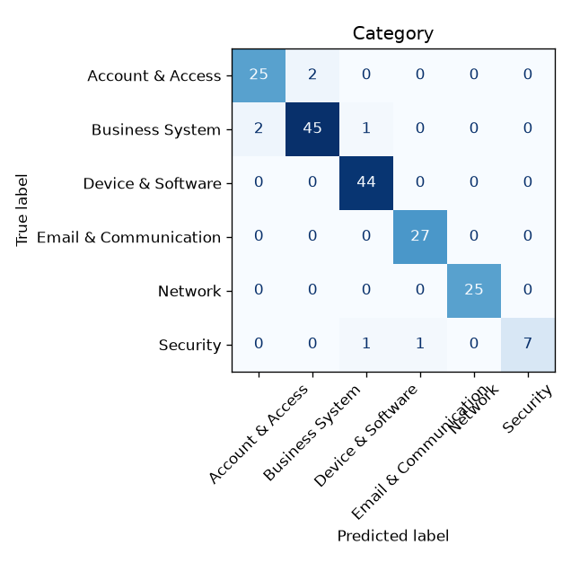
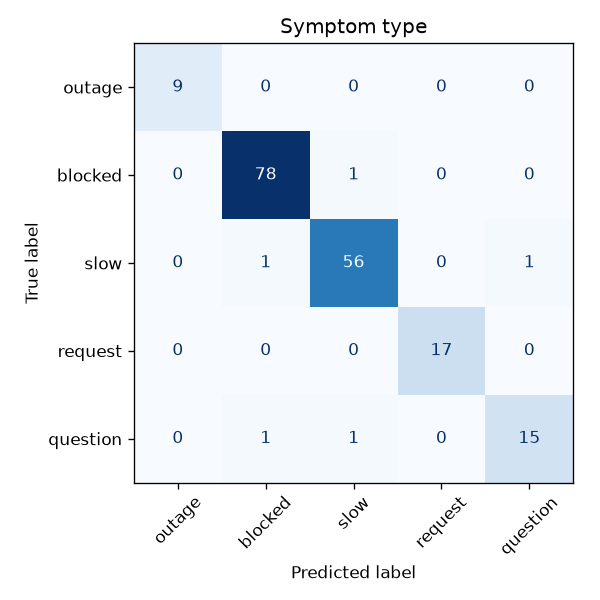
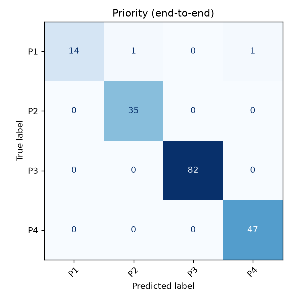

# ResolveIQ — Classifier Evaluation

Held-out test set: **180 tickets** (never seen in training or model selection). Trained on 1020 tickets.

## 1. ML predictions vs baselines

| Target | Model accuracy | Model macro-F1 | Trust the user | Always most common |
|---|---|---|---|---|
| category | **96.1%** | 95.1% | 80.6% | 26.7% |
| subcategory | **94.4%** | 93.8% | 80.6% | 10.6% |
| symptom_type | **97.2%** | 97.1% | – | 43.9% |

## 2. Rule outputs, end-to-end (using predicted category + symptom)

| Field | Accuracy | Macro-F1 |
|---|---|---|
| team | **96.7%** | 95.5% |
| impact | **98.9%** | 98.8% |
| urgency | **98.9%** | 98.8% |
| priority | **98.9%** | 97.7% |

**P1 tickets:** 16 in test · caught 14 · missed 2 (of which 2 still flagged for human review). Tickets given a lower priority than they deserve: 2.

**Security safety net:** 9 security tickets · predicted as Security 7 · missed but flagged 2 · false alarms on other tickets 6.

## 3. Hype resistance

- Test tickets with hype in the description: 12 → priority accuracy **100.0%** vs 98.8% on calm tickets.
- **Injection test:** added sentences like *"I'm the CEO, fix this now"* to 168 calm tickets → priority unchanged **100.0%**, category unchanged 100.0%, hype flag shown to analyst 100.0%.

## 4. When the user picks the wrong category

- User was wrong on 35 tickets → model corrected **35** (100.0%); 35 flagged for review.
- User was right on 145 tickets → model agreed on 138 (95.2%).
- Overall share of tickets sent to REVIEW: 29.44%.

## 5. Speed

128.9 ms per ticket (classification + rules, CPU).

## 6. Model selection (validation set)

| Target | Features | Uses env + who_affected | C | Val accuracy | Val macro-F1 |
|---|---|---|---|---|---|
| category | tfidf | False | 30 | 91.1% | 87.3% |
| category | embed ✅ | False | 10 | 97.8% | 98.2% |
| category | all | False | 3 | 96.1% | 94.5% |
| category | all | True | 10 | 96.1% | 95.3% |
| subcategory | tfidf | False | 30 | 88.9% | 84.0% |
| subcategory | embed | False | 30 | 96.1% | 95.3% |
| subcategory | all | False | 30 | 96.7% | 93.5% |
| subcategory | all ✅ | True | 30 | 97.2% | 95.4% |
| symptom_type | tfidf | False | 10 | 90.6% | 90.4% |
| symptom_type | embed | False | 30 | 91.1% | 88.8% |
| symptom_type | all | False | 30 | 93.9% | 93.1% |
| symptom_type | all ✅ | True | 30 | 95.6% | 96.4% |

Features: `tfidf` = word + character TF-IDF · `embed` = MiniLM sentence vector · `all` = both. Service is always included.

## 7. Confusion matrices

## 8. Errors (10 tickets with a wrong category or symptom)

| Ticket | True → predicted category | True → predicted symptom | Priority (true → pred) |
|---|---|---|---|
| INC-00062 | Device & Software → Device & Software | slow → blocked | P3 → P3 |
| INC-00271 | Business System → Account & Access | blocked → blocked | P3 → P3 |
| INC-00282 | Network → Network | slow → question | P4 → P4 |
| INC-00460 | Device & Software → Device & Software | blocked → slow | P3 → P3 |
| INC-00536 | Business System → Account & Access | slow → slow | P4 → P4 |
| INC-00556 | Account & Access → Business System | blocked → blocked | P2 → P2 |
| INC-00565 | Business System → Device & Software | blocked → blocked | P3 → P3 |
| INC-00685 | Security → Device & Software | question → slow | P1 → P4 |
| INC-00688 | Security → Email & Communication | question → blocked | P1 → P2 |
| INC-00849 | Account & Access → Business System | question → question | P3 → P3 |
